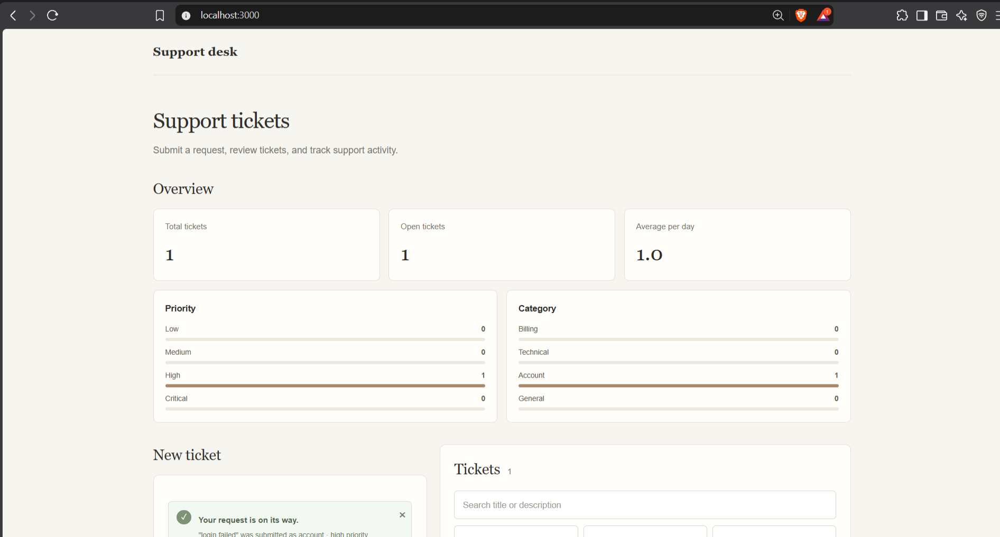
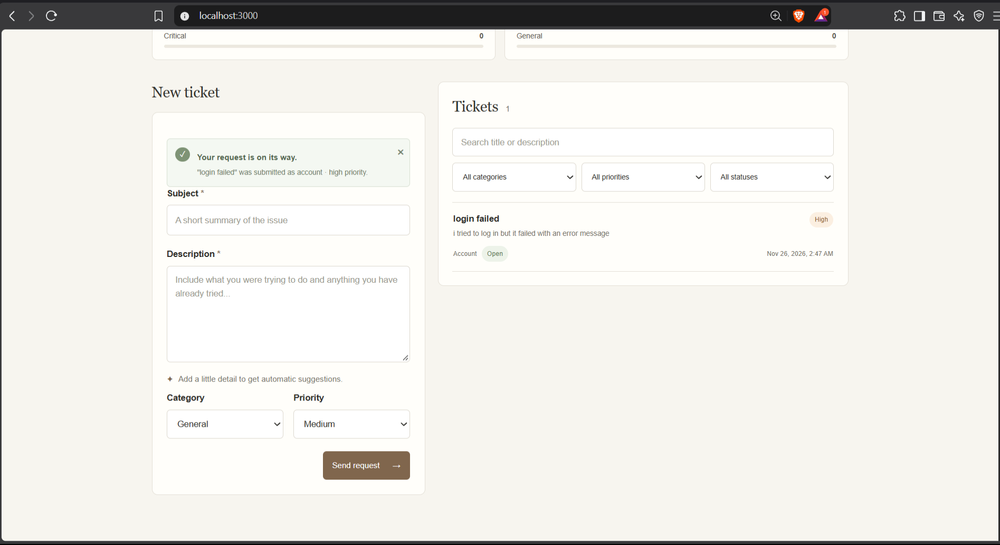

# Support Ticket System

A simple support desk for submitting, organizing, and tracking customer tickets. The app includes a Next.js dashboard, a Django REST API, and PostgreSQL storage.

## Features

- Submit tickets with a subject, description, category, and priority.
- Get AI suggested categories and priorities from the ticket description using the Google Gemini API. Suggestions are optional; categories and priorities can be set manually.
- Search tickets and filter them by category, priority, or status.
- Update a ticket's status and view ticket details.
- See ticket totals and breakdowns by status, category, and priority.

## Screenshots





## Run with Docker Compose

You will need [Docker Desktop](https://www.docker.com/products/docker-desktop/) or Docker Engine with the Compose plugin.

1. Clone this repository and open a terminal in the project folder.
2. (Optional) Copy `.env.example` to `.env` and add a `GEMINI_API_KEY` to enable AI suggestions. Without a key, tickets can still be submitted with manually selected categories and priorities.
3. Start the app:

   ```bash
   docker compose up --build
   ```

4. Open the dashboard at [http://localhost:3000](http://localhost:3000).

The API is available at [http://localhost:8000](http://localhost:8000). Docker Compose starts PostgreSQL and runs the database migrations automatically. To stop the app, press `Ctrl+C`; to stop and remove its containers, run `docker compose down`.

## Configuration

The root `.env` file is used by Docker Compose. Available settings are listed in `.env.example`:

| Variable | Purpose |
| --- | --- |
| `GEMINI_API_KEY` | Optional key for AI ticket suggestions. |
| `GEMINI_MODEL` | Gemini model used for suggestions (defaults to `gemini-2.5-flash`). |
| `DB_NAME`, `DB_USER`, `DB_PASSWORD` | PostgreSQL database credentials. |
| `DJANGO_SECRET_KEY` | Django secret key. Set a private value outside local development. |
| `DJANGO_DEBUG` | Django debug mode; enabled by default for local development. |

## Tech stack

- Frontend: Next.js, React, and TypeScript
- Backend: Django and Django REST Framework
- Database: PostgreSQL
- Optional ticket classification: Google Gemini
